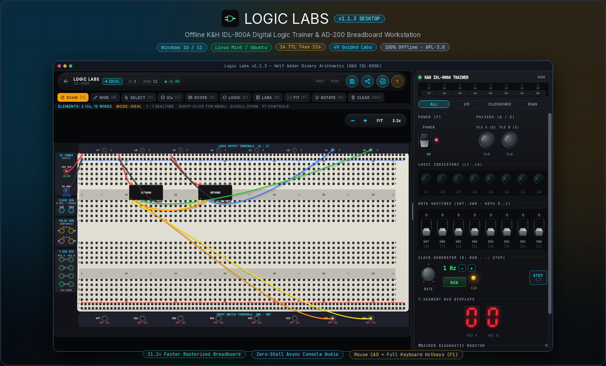
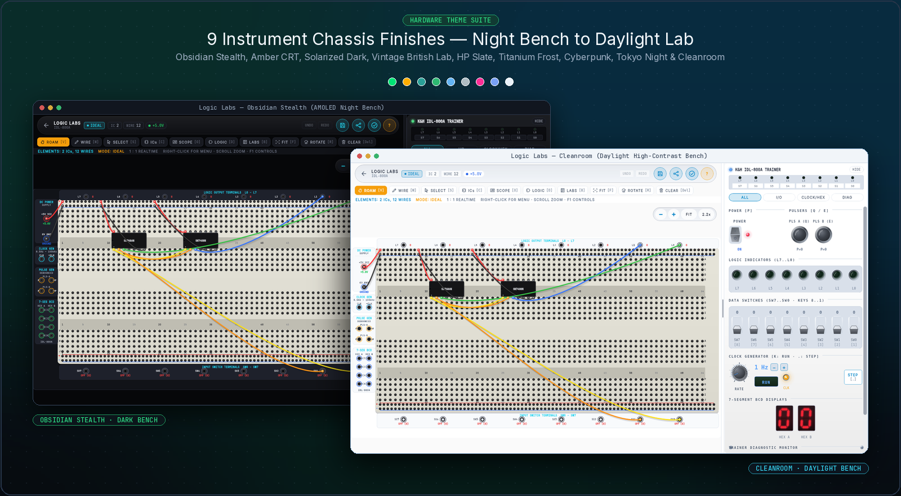
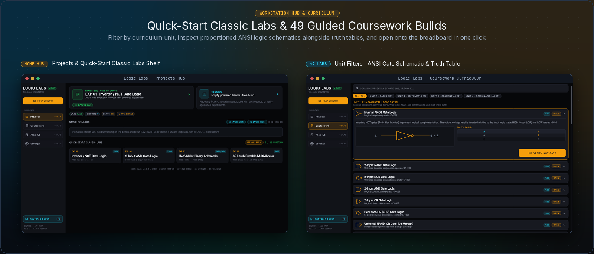
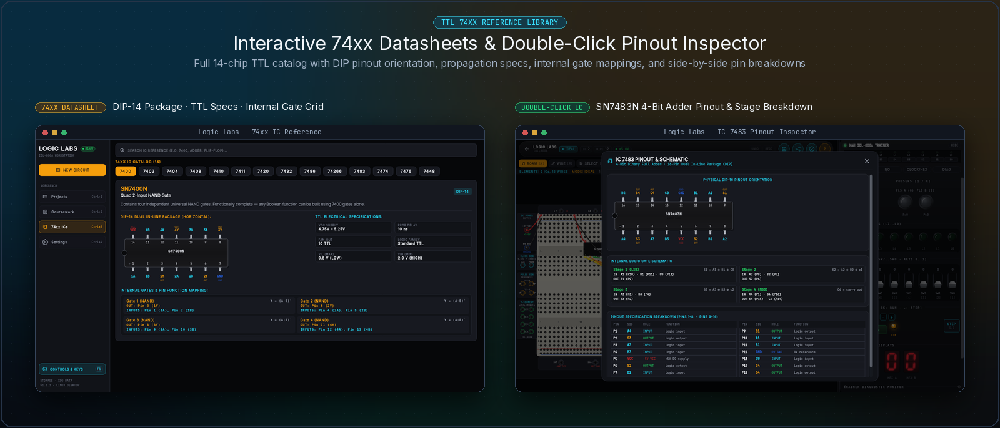
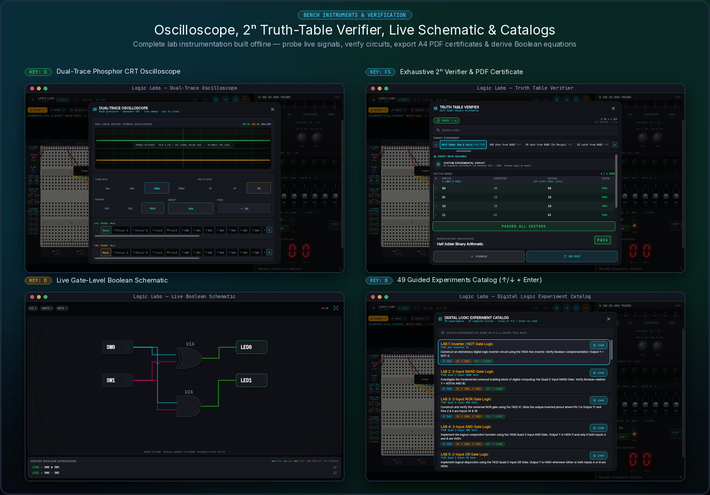
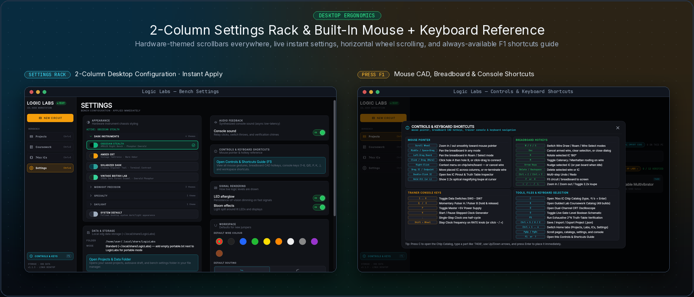
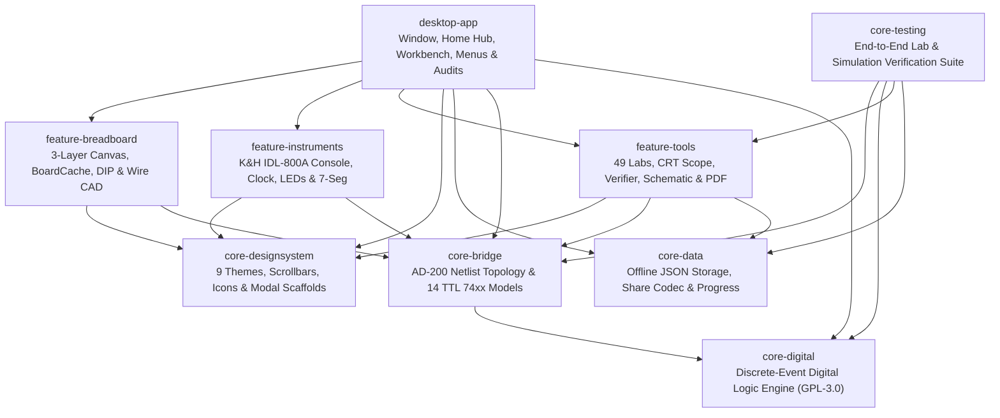

<div align="center">

<a href="https://github.com/AdnanFoisal/LogicLabs-Desktop/releases/latest">
  
</a>

<br />
<br />

# Logic Labs — Desktop Edition

**A fast, 100% offline digital twin of the K&H IDL-800A Digital Logic Trainer & AD-200 Breadboard for Linux Mint, Ubuntu/Debian, and Windows 10/11.**

[](https://github.com/AdnanFoisal/LogicLabs-Desktop/releases/latest)
[](https://github.com/AdnanFoisal/LogicLabs-Desktop/releases/latest)
[](gradle/libs.versions.toml)
[](#building--testing-from-source)
[](LICENSE)

<p>
  <a href="#download--install">Download &amp; Install</a> &nbsp;·&nbsp;
  <a href="#visual-tour">Screenshots</a> &nbsp;·&nbsp;
  <a href="#key-features">Features</a> &nbsp;·&nbsp;
  <a href="#controls--keyboard-shortcuts">Shortcuts</a> &nbsp;·&nbsp;
  <a href="#performance-4-gb-ram-friendly">Performance</a> &nbsp;·&nbsp;
  <a href="#navigating-this-repository">Repository Guide</a> &nbsp;·&nbsp;
  <a href="#building--testing-from-source">Build From Source</a>
</p>

</div>

---

## What Is Logic Labs Desktop?

**Logic Labs Desktop** is the native PC workstation port of [Logic Labs](https://github.com/AdnanFoisal/LogicLabs) (originally created for Android by Adnan Foisal, CUET CSE). Rebuilt with **Kotlin** and **Compose Multiplatform Desktop (Skia/JVM)**, it transforms the classic university digital-electronics trainer bench into a snappy desktop CAD application tailored for **mouse pointer precision**, **full keyboard control**, and **smooth performance even on 4 GB RAM Linux Mint & Windows laptops**.

- **Zero Java installation required** — every release bundles Eclipse Temurin 21 JRE.
- **Zero accounts, zero telemetry, 100% offline** — your circuits stay on your machine (or a USB drive).
- **14 authentic TTL 74xx DIP ICs**, **49 guided coursework labs**, **Dual-Trace CRT Oscilloscope**, **Live Gate-Level Boolean Schematic**, and **Exhaustive $2^N$ Truth-Table Verification with A4 PDF Lab Certificates**.

---

## Download & Install

Grab the latest binaries from the [**GitHub Releases page**](https://github.com/AdnanFoisal/LogicLabs-Desktop/releases/latest):

| Platform | Package | Size | Notes |
| :--- | :--- | :---: | :--- |
| **Linux Mint / Ubuntu / Debian (x64)** | [`logic-labs_1.1.3_amd64.deb`](https://github.com/AdnanFoisal/LogicLabs-Desktop/releases/download/v1.1.3/logic-labs_1.1.3_amd64.deb) | 76.5 MB | **Recommended.** App menu shortcut, icons & `logic-labs` CLI command |
| **Linux Mint / Debian Portable (x64)** | [`LogicLabs-Linux-Mint-Portable.tar.gz`](https://github.com/AdnanFoisal/LogicLabs-Desktop/releases/download/v1.1.3/LogicLabs-Linux-Mint-Portable.tar.gz) | 92.8 MB | No `sudo` required; extract anywhere and run `./LogicLabs` |
| **Windows 10 / 11 (x64)** | [`LogicLabs-Windows-Portable.zip`](https://github.com/AdnanFoisal/LogicLabs-Desktop/releases/download/v1.1.3/LogicLabs-Windows-Portable.zip) | 87.7 MB | Extract anywhere and double-click `LogicLabs.exe` |

### Linux Mint / Ubuntu / Debian (x64)

#### Option 1 — Quick Terminal Install or Upgrade (`.deb`, Recommended)
Works identically for a fresh install **or** upgrading from an older version (your saved circuits in `~/.local/share/LogicLabs` are always preserved):

```bash
curl -fSLO https://github.com/AdnanFoisal/LogicLabs-Desktop/releases/download/v1.1.3/logic-labs_1.1.3_amd64.deb
sudo apt install -y ./logic-labs_1.1.3_amd64.deb
```

Then launch **Logic Labs** from your **Application Menu → Education / Programming**, or run:

```bash
logic-labs
```

> **Prefer clicking instead of the terminal?** Download [`logic-labs_1.1.3_amd64.deb`](https://github.com/AdnanFoisal/LogicLabs-Desktop/releases/download/v1.1.3/logic-labs_1.1.3_amd64.deb) in your browser and double-click it in Nemo/Caja — Linux Mint's **GDebi Package Installer** will install it in one click.

#### Option 2 — Portable Archive (Zero `sudo` Required)

```bash
curl -fSLO https://github.com/AdnanFoisal/LogicLabs-Desktop/releases/download/v1.1.3/LogicLabs-Linux-Mint-Portable.tar.gz
tar -xzf LogicLabs-Linux-Mint-Portable.tar.gz
cd LogicLabs-Linux-Mint-Portable
./LogicLabs
```

Optional: run `./install-desktop-shortcut.sh` inside the extracted folder to add Logic Labs to your user application menu without root privileges.

#### Linux Compatibility & Uninstall Tips
- **Compatibility:** Bundles Eclipse Temurin 21 + Skiko Linux x64 (`GLIBC 2.17+`), tested for **Linux Mint 19, 20, 21, 22 & LMDE**.
- **Older GPUs / Virtual Machines:** Logic Labs automatically detects Mesa `llvmpipe` / broken OpenGL drivers and switches to Skia software rendering cleanly. You can also force software mode anytime with `logic-labs --software` (or `./LogicLabs-SoftwareRender.sh`).
- **Uninstall (`.deb`):** `sudo apt remove logic-labs` (add `--purge` if desired; user data in `~/.local/share/LogicLabs` stays safe).

---

### Windows 10 / 11 (x64)

1. Download [**`LogicLabs-Windows-Portable.zip`**](https://github.com/AdnanFoisal/LogicLabs-Desktop/releases/download/v1.1.3/LogicLabs-Windows-Portable.zip).
2. Right-click the ZIP → **Extract All…** into a normal folder (for example `C:\LogicLabs`). *(Do not run directly from inside Windows' ZIP preview.)*
3. Double-click **`LogicLabs.exe`**.
   - Includes a Per-Monitor V2 DPI manifest for crisp text on 100%–150% scaled laptops (`1366×768` up to 4K).
   - Automatically falls back to software rendering if an older Windows 10 GPU driver rejects Direct3D — or launch explicitly via `LogicLabs-SoftwareRender.bat`.

---

### Where Projects Are Saved & Portable USB Mode

| Mode | Linux Mint / Ubuntu | Windows 10 / 11 |
| :--- | :--- | :--- |
| **Standard (Default)** | `~/.local/share/LogicLabs/` | `%APPDATA%\LogicLabs\` |
| **Portable / USB Drive** | `<app-folder>/data/` | `<app-folder>\data\` |

To enable **Portable / USB Mode**, simply place an empty file named `portable.txt` right next to `LogicLabs` (or `LogicLabs.exe`). You can open your data folder anytime inside the app via **Settings → Open Projects & Data Folder** or **File → Open Projects Folder**.

---

## Visual Tour

### 9 Hardware Instrument Chassis Themes (Night Bench to Daylight Lab)
Switch instantaneously between 9 hardware-inspired themes — including **Obsidian Stealth**, **Amber CRT**, **Solarized Dark**, **Vintage British Lab**, **HP Slate**, **Titanium Frost**, **Cyberpunk Neon**, **Tokyo Night**, and high-contrast **Cleanroom** daylight mode.

<div align="center">
  
</div>

### Projects Hub & 49 Guided Digital Logic Coursework Labs
Start right away from the **Quick-Start Classic Labs** shelf or filter all **49 coursework builds** by curriculum unit (Fundamental Gates, Arithmetic, Sequential, Combinational) with proportioned ANSI gate schematics rendered right beside their truth tables.

<div align="center">
  
</div>

### Interactive 74xx IC Reference & Double-Click Pinout Inspector
Inspect all **14 TTL 74xx chips** in a 2-column desktop datasheet with DIP-14 / DIP-16 pinout orientation, electrical specs, and internal gate mappings — or **double-click any IC on the breadboard** to open its live pinout & truth-table inspector modal.

<div align="center">
  
</div>

### Full Lab Instrumentation — Oscilloscope, 2ⁿ Verifier, Live Schematic & Catalogs
Everything you need on a real electronics lab bench, running 100% offline: Dual-Trace Phosphor CRT Oscilloscope (`O`), Exhaustive $2^N$ Truth-Table Verifier with HMAC-SHA256 seal & A4 PDF Certificate export (`F5`), Live Gate-Level Boolean Schematic with derived equations (`D`), and keyboard-searchable 49-lab catalog (`B`).

<div align="center">
  
</div>

### Desktop Ergonomics — 2-Column Settings Rack & Built-In `F1` Shortcuts Guide
Every scrollable panel features hardware-themed scrollbars, horizontal mouse-wheel scrolling with overflow arrows, `PageUp`/`PageDown` navigation, live instant settings, and an always-reachable **Controls & Keyboard Shortcuts** reference (`F1` or `?`).

<div align="center">
  
</div>

---

## Key Features

- **Authentic AD-200 Breadboard & 14 TTL 74xx ICs:** `7400`, `7402`, `7404`, `7408`, `7410`, `7411`, `7420`, `7432`, `7448`, `7474`, `7476`, `7483`, `7486`, and `74266` with realistic DIP footprints, hover socket voltage/pin readouts, catenary & Manhattan jumper routing, and multi-step **Undo / Redo (`Ctrl+Z` / `Ctrl+Y`)**.
- **K&H IDL-800A Trainer Console Rack:** Resizable/collapsible right-hand workstation dock featuring Master `+5V` Power (`P`), Data Switches `SW0–SW7` (`1–8`), Momentary Pulsers `A`/`B` (`Q`/`E`), Logic LEDs `L0–L7` with POV afterglow, Dual 7-Segment BCD/Hex Displays, Stepped Clock Generator (`1 Hz – 100 kHz` + Single-Step `.`), Diagnostics, and `IDEAL` vs `PRACTICAL` IC short-circuit/burnout physics.
- **49 Guided Experiments & Automated Grading:** 12 core curriculum labs + 37 extended bench builds, live truth-table verification across all $2^N$ input combinations, HMAC-SHA256 verification seal, and printable **A4 PDF Lab Certificates** (via Apache PDFBox).
- **Zero-Friction Sharing:** Export/import portable `.logiclabs.json` project files or share compact `LOGIC-...` clipboard codes between Desktop and Android builds.

---

## Controls & Keyboard Shortcuts

Press **`F1`** or **`?`** anywhere inside the app to view the interactive Controls Guide.

<details open>
<summary><strong>Mouse Pointer CAD Gestures</strong></summary>

| Action | Gesture |
| :--- | :--- |
| **Zoom smoothly toward cursor** | `Scroll Wheel` |
| **Pan breadboard (any tool)** | `Middle-Click + Drag` or `Space + Left-Drag` |
| **Pan breadboard (Roam / Select)** | `Left-Drag` on empty board |
| **Route jumper wire** | `Left-Click` hole A then hole B, or `Click + Drag` (in Wire mode `W`) |
| **Move IC or re-terminate wire** | `Left-Drag` IC body or wire endpoint |
| **Context menu / cancel armed wire** | `Right-Click` on IC, wire, or board |
| **Open live IC Pinout Inspector** | `Double-Click` any placed IC |
| **2.2× Optical Magnifying Loupe** | Hold `Alt` (or press `L` to toggle) |
| **Step Clock Rate dial** | `Shift + Scroll Wheel` over rate knob (or click `−` / `+`) |

</details>

<details open>
<summary><strong>Keyboard Shortcuts (Breadboard, Trainer Console & Tools)</strong></summary>

| Category | Key(s) | Action |
| :--- | :--- | :--- |
| **Tools** | `W` / `V` / `S` | Switch **Wire Draw** / **Roam** / **Wire Select** mode |
| **Editing** | `R` / `M` / `Delete` | Rotate IC 180° / Toggle Catenary–Manhattan wire / Delete selected |
| **Editing** | `Arrow Keys` | Nudge selected IC across columns (or pan board when idle) |
| **History** | `Ctrl+Z` / `Ctrl+Y` | Multi-step Undo / Redo |
| **View** | `F` or `0` / `+` / `-` / `L` | Fit breadboard to view / Zoom in / Zoom out / Toggle 2.2× loupe |
| **Console** | `1` .. `8` | Toggle Data Switches `SW0` .. `SW7` |
| **Console** | `Q` / `E` / `P` | Hold Pulser A / Hold Pulser B / Toggle Master `+5V` Power |
| **Console** | `K` / `.` | Start–Pause Clock Generator / Single-Step Clock one half-cycle |
| **Instruments** | `C` / `B` / `O` / `D` / `F5` | Chip Catalog / 49 Labs Catalog / Oscilloscope / Schematic / Verify $2^N$ |
| **Files & Nav** | `Ctrl+S` / `Ctrl+E` / `Ctrl+O` | Save project / Export `.json` / Import `.json` |
| **Navigation** | `Ctrl+1..4` / `PgUp` `PgDn` / `F1` | Switch Home tabs / Scroll active panel / Open Controls Guide |

</details>

---

## Performance (4 GB RAM Friendly)

`v1.1.3` was specifically engineered and benchmarked to stay snappy and low-memory on **4 GB RAM Linux Mint & Windows laptops** — even when using software rendering:

| Subsystem | Before (`v1.1.2`) | After (`v1.1.3`) | Improvement |
| :--- | :---: | :---: | :---: |
| **Breadboard Redraw (`BoardCache`)** | 39.60 ms / frame (`Picture` replay) | **3.52 ms / frame** (offscreen Skia `Image`) | **11.2× faster** |
| **Offscreen Cache Footprint** | Unbounded Skia vector display list | **8.70 MB** (capped & pooled) | Predictable RAM |
| **Console Audio Clicks (`ConsoleSfx`)** | Blocking `SourceDataLine` on UI thread | **0.0117 ms / click** (async daemon worker) | **Zero UI stutter** |
| **Idle GPU / CPU Overhead** | 16 px Gaussian blur + 60 FPS idle loops | Event-driven invalidation, crisp vector strokes | Near-0% idle CPU |
| **JVM Heap & GC Tuning** | Unbounded default G1GC heap | `-Xms48m -Xmx320m -XX:+UseSerialGC` | Ideal for 4 GB RAM |

---

## Navigating This Repository

Logic Labs Desktop is organized as a clean **9-module Gradle multi-project workspace** with strict unidirectional dependencies so the simulation core can be tested independently of the desktop UI:



### Quick "Where Do I Look?" Map

| Directory / File | Responsibility | Start Here When You Want To… |
| :--- | :--- | :--- |
| [`core-digital/`](core-digital/) | Pure JVM discrete-event logic engine (derived from `hneemann/Digital`) | Inspect gate propagation, tri-state signals, or bus conflicts |
| [`core-bridge/`](core-bridge/) | AD-200 breadboard tie-point DSU netlist, 14 TTL 74xx IC definitions (`TTLChipCatalog`), `IDEAL` vs `PRACTICAL` physics | Add a new 74xx IC model or adjust pinout/burnout rules |
| [`core-data/`](core-data/) | Offline JSON persistence, autosave drafts, `LOGIC-...` share codec, settings & badge progress | Change saved project schema, portable storage, or share codes |
| [`core-designsystem/`](core-designsystem/) | 9 `HardwareTheme` palettes, Inter/JetBrains Mono fonts, vector icons, `DesktopScrollbars`, `DesktopModalDialog` | Add a theme, tweak scrollbars, or adjust shared desktop dialogs |
| [`feature-breadboard/`](feature-breadboard/) | 3-layer `BreadboardCanvas`, rasterized `BoardCache`, `DipPainter`, `WirePainter`, `LoupeRenderer`, mouse/key gestures | Modify breadboard rendering, wire routing, zoom/pan, or loupe |
| [`feature-instruments/`](feature-instruments/) | K&H IDL-800A `TrainerConsoleDock`, `ClockDial`, `RockerSwitch`, `LedLens`, `MomentaryPulser`, `SevenSegModule` | Edit trainer console controls, clock dial, or diagnostics |
| [`feature-tools/`](feature-tools/) | 49 guided labs (`LabCurriculum`, `ExperimentCatalog`), `ScopePanel`, `BooleanDiagramView`, `TestBenchVerifier`, `LabCertificatePdf`, async `ConsoleSfx` | Add coursework labs, edit oscilloscope/verifier/PDF export, or tune audio |
| [`desktop-app/`](desktop-app/) | Entry point (`Main.kt`), Home Hub (`HomeScreen`, `CourseworkTab`, `IcReferenceTab`, `SettingsScreen`), Workbench (`LogicLabsMainScreen`, `CommandBar`), visual & perf tests | Modify top-level windows, menu bar, global hotkeys, or Home/Workbench layouts |
| [`core-testing/`](core-testing/) | Automated multi-module simulation & coursework verification tests | Add automated circuit verification test cases |
| [`packaging/`](packaging/) | Cross-platform packagers (`build-linux-mint.sh`, `build-portable-windows.sh`), Linux launcher, Win64 C launcher & DPI manifest | Adjust `.deb`, portable `.tar.gz`, Windows `.exe` launcher, or JVM flags |
| [`docs/screenshots/`](docs/screenshots/) | Professionally edited studio showcase PNGs rendered in this README | Update documentation imagery |
| [`.github/`](.github/) | CI workflow (`ci-build.yml`), Windows installer build (`build-windows.yml`), and issue templates | Customize CI/CD or GitHub templates |

---

## Building & Testing From Source

### Prerequisites
- **JDK 21** (Eclipse Temurin 21 recommended; bytecode targets JVM 17)
- Git (and `mingw-w64` + `dpkg-deb` only if cross-building portable release bundles on Linux)

### Run the Desktop App Locally (Linux / Windows / macOS)

```bash
git clone https://github.com/AdnanFoisal/LogicLabs-Desktop.git
cd LogicLabs-Desktop
./gradlew :desktop-app:run
```

*(On Windows PowerShell/CMD, replace `./gradlew` with `.\gradlew.bat`.)*

### Run the Full 9-Module Test & Benchmark Suite (301 Tests)

```bash
./gradlew test
```

### Build Distributable Packages

```bash
# Build Linux Mint / Debian .deb & Portable .tar.gz (outputs to dist/linux/ by default)
./packaging/build-linux-mint.sh

# Cross-build Windows 10/11 Portable .zip from Linux (requires mingw-w64, zip, unzip)
./packaging/build-portable-windows.sh
```

On Windows 10/11 (with JDK 21 + WiX 3.x), build native `.exe` / `.msi` installers with:

```bat
build-windows.bat
```

### Capture Headless Visual Audit Screenshots

```bash
./gradlew :desktop-app:test \
  --tests "com.logiclabs.app.DesktopVisualAuditTest" \
  -Dlogiclabs.captureScreenshots=build/screenshots
```

---

## Contributing & Changelog

- Read [**`CONTRIBUTING.md`**](CONTRIBUTING.md) for development workflow, module boundaries, and PR guidelines.
- Read [**`CHANGELOG.md`**](CHANGELOG.md) for full release notes across `v1.1.3` and `v1.1.2`.
- Found a bug or want to suggest a new 74xx IC / lab? Open an issue using our [Bug Report](.github/ISSUE_TEMPLATE/bug_report.md) or [Feature Request](.github/ISSUE_TEMPLATE/feature_request.md) templates.

---

## License & Attribution

- Licensed under **GPL-3.0-only** — see [`LICENSE`](LICENSE) and [`THIRD_PARTY_NOTICES.md`](THIRD_PARTY_NOTICES.md).
- Original **Logic Labs** Android application by [**Adnan Foisal (CUET CSE)**](https://github.com/AdnanFoisal/LogicLabs).
- `:core-digital` discrete-event simulation kernel derived from [**hneemann/Digital**](https://github.com/hneemann/Digital) (GPL-3.0).
